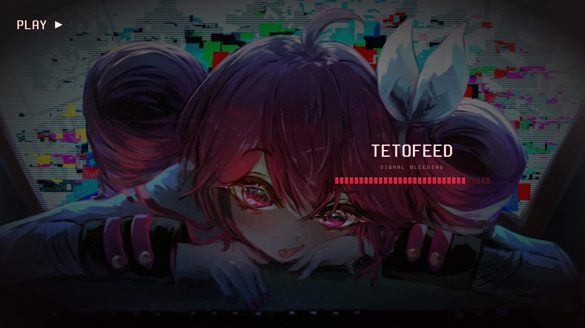
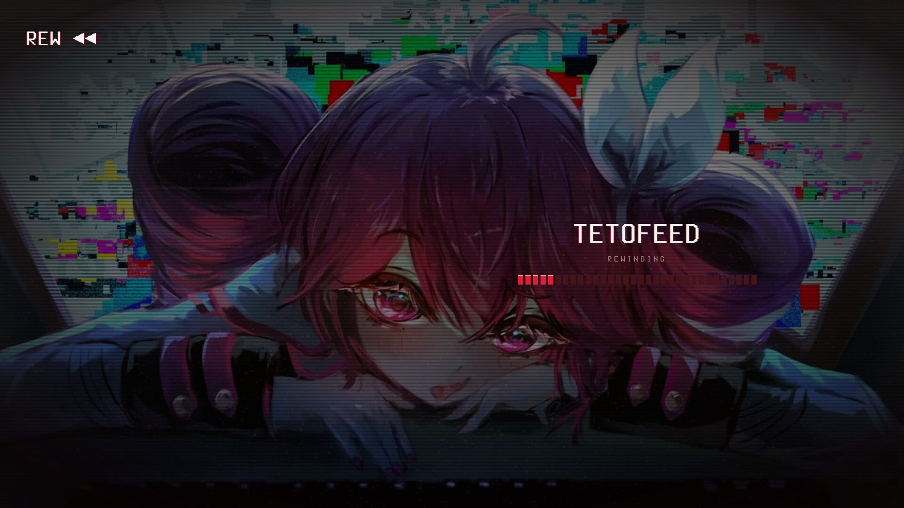

# Tetofeed — Global Theme (Plasma 6)

The Tetofeed global theme: switches Plasma to the whole suite at once, and ships the VHS rewind/play splash screen.


Tetofeed is a red twindrilled VHS look for KDE Plasma 6, built around a crimson-lit face on near-black: blood-black surfaces, faint scanlines and tape grain, and a slight crimson glow on whatever has focus.

## Features

- **Splash screen:** the tape rewinds (`REW ◀◀`, fast tracking band) and then plays (`PLAY ▶`). Tape blocks fill as Plasma's six startup stages arrive.
- **Defaults:** colour scheme, Plasma style, icons, Kvantum widget style, Aurorae window decoration and splash, all set to Tetofeed.
- **Ships no panel layout,** so applying it never rearranges your panels or widgets.




## Requirements

Plasma 6. Install the other Tetofeed pieces first (colour scheme, Plasma style, Aurorae, icons, Kvantum), or the global theme falls back to Breeze for whatever is missing. Kvantum needs `kvantum` installed.

## Install

```bash
git clone https://github.com/sheepy1335/tetofeed-global
cd tetofeed-global && ./install.sh
```

Or from the KDE Store: System Settings → Colors & Themes → Global Theme → Get New... → Tetofeed Global Theme,
- System Settings → Colors & Themes → Global Theme → Install from File, 
- or extract to `~/.local/share/plasma/look-and-feel/`. The splash alone can be picked under Colors & Themes → Splash Screen.

## The rest of the suite

| piece | repo |
|---|---|
| SDDM login | [tetofeed-sddm](https://github.com/sheepy1335/tetofeed-sddm) |
| Plymouth boot splash | [tetofeed-plymouth](https://github.com/sheepy1335/tetofeed-plymouth) |
| Plasma splash screen | [tetofeed-splash](https://github.com/sheepy1335/tetofeed-splash) |
| Plasma style (panel, popups) | [tetofeed-plasma](https://github.com/sheepy1335/tetofeed-plasma) |
| Aurorae window decoration | [tetofeed-aurorae](https://github.com/sheepy1335/tetofeed-aurorae) |
| Colour scheme | [tetofeed-colors](https://github.com/sheepy1335/tetofeed-colors) |
| Kvantum widget style | [tetofeed-kvantum](https://github.com/sheepy1335/tetofeed-kvantum) |
| Icon theme | [tetofeed-icons](https://github.com/sheepy1335/tetofeed-icons) |
| Konsole + kitty colours | [tetofeed-konsole](https://github.com/sheepy1335/tetofeed-konsole) |

Everything at once, with the generators: [tetofeed](https://github.com/sheepy1335/tetofeed).

## Tags

`tetofeed` `kde` `plasma6` `dark` `vhs` `scanlines` `crimson` `red` `blood` `horror` `retro` `analog-horror` `glow` `global-theme` `look-and-feel` `splash-screen` `ksplash` `plasma-6`

## Credits and licence

- By sheepy1335, customised from [Bloodfeed Global](https://github.com/numbpill3d/bloodfeed-global) by numbpill3d. GPL-3.0-or-later.
- Wallpaper is from [wallpapers.com](https://wallpapers.com/wallpapers/kasane-teto-digital-art-qtho2b0qil6f2n3q.html)
- OSD font: Terminess Nerd Font (Terminus, SIL OFL 1.1), bundled with its licence.
- Mini teto icons (/extras/icons/Tetofeed/scalable/apps) are from [Pinterest](https://www.pinterest.com/haguepvlslola/art-styles-i-find-nice/)
